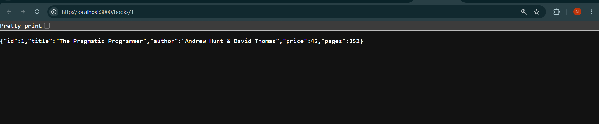
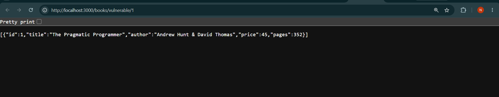
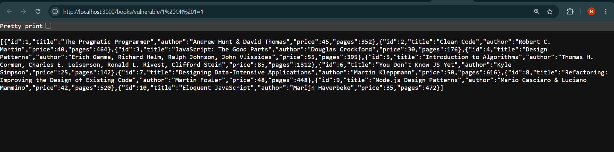
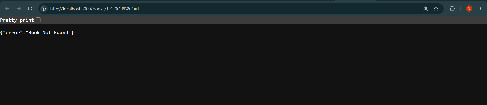

# Lecture: SQL Injection Demonstration & Prevention in Node.js / Express

## Student Details

- **Student Name:** Nanda Kishore
- **Registration Number:** 252U1R9129
- **Section:** CSE GEN AI (2C)
- **Course:** Backend Development Fundamentals
- **Academic Term:** Year II – Term II
- **Faculty:** Joel Prashanth D

---

## 1. Overview & Presentation

This folder contains a lecture demonstration comparing **vulnerable SQL execution** (using template literals / string interpolation) against **secure SQL execution** (using parameterized queries with `?` placeholders).

- **Lecture Presentation File:** [`book_sql_injection_3_slides.pptx`](./book_sql_injection_3_slides.pptx)

---

## 2. Project Structure

```text
student lecture/
├── book_sql_injection_3_slides.pptx  # 3-Slide presentation explaining SQL Injection
├── server.js                         # Server with both vulnerable & secure demonstration routes
├── database.db                       # SQLite database file containing the book table
├── seed.sql                          # SQL schema definition & initial 10 records
├── package.json                      # Project metadata & start script
├── package-lock.json                 # Dependency lockfile
├── .gitignore                        # Excludes node_modules/ and .env
└── README.md                         # Demonstration guide & exploit walk-through
```

---

## 3. The 3 Lecture Demonstration Endpoints

| Route | Security Level | Method | Purpose |
|---|---|---|---|
| `GET /books` | Standard | `GET` | Retrieve list of all books |
| `GET /books/vulnerable/:bookId` | ❌ **VULNERABLE** | `GET` | Demonstrates SQL Injection exploit via string interpolation |
| `GET /books/:bookId` |  **SECURE** | `GET` | Demonstrates SQL Injection prevention via parameterized queries |

---

## 4. Live Demonstration Walkthrough

### Part A: The Vulnerability (String Interpolation)

In [`server.js`](./server.js), the vulnerable route is implemented as:

```javascript
app.get('/books/vulnerable/:bookId', async (request, response) => {
  const { bookId } = request.params

  // VULNERABLE: Direct string interpolation
  const query = `
    SELECT *
    FROM book
    WHERE id = ${bookId};
  `

  const books = await db.all(query)
  response.status(200).json(books)
})
```

#### Step 1: Normal Request
- **URL:** `http://localhost:3000/books/vulnerable/1`
- **Executed SQL:**
  ```sql
  SELECT * FROM book WHERE id = 1;
  ```
- **Result:** Returns only book 1 (`The Pragmatic Programmer`).

#### Step 2: The Attack (Bypassing Filter with `1 OR 1=1`)
- **URL:** `http://localhost:3000/books/vulnerable/1 OR 1=1`  
  *(in browser address bar: `http://localhost:3000/books/vulnerable/1%20OR%201=1`)*
- **Executed SQL:**
  ```sql
  SELECT * FROM book WHERE id = 1 OR 1=1;
  ```
- **Result:** Because `1=1` is always `TRUE`, the `WHERE` condition matches every row in the database. **All 10 books are dumped to the client**, exposing the security breach.

---

### Part B: The Prevention (Parameterized Queries)

The secure route is implemented as:

```javascript
app.get('/books/:bookId', async (request, response) => {
  const { bookId } = request.params

  // SECURE: Uses '?' placeholder
  const query = `
    SELECT *
    FROM book
    WHERE id = ?;
  `

  const book = await db.get(query, [bookId])

  if (book === undefined) {
    return response.status(404).json({ error: 'Book Not Found' })
  }

  response.status(200).json(book)
})
```

#### Step 3: Testing the Exploit Against the Secure Route
- **URL:** `http://localhost:3000/books/1 OR 1=1`
- **Result:**
  - Status: `404 Not Found`
  - Body: `{"error": "Book Not Found"}`
- **Why It Works:** SQLite treats `'1 OR 1=1'` strictly as a string literal value. It looks for a book with `id = '1 OR 1=1'`. Finding none, it safely returns `404` without executing the attacker's `OR` statement.

---

## 5. How to Run the Demonstration

1. Open PowerShell and navigate to this folder:
   ```powershell
   cd "c:\Users\nandu\Desktop\express\student lecture"
   ```
2. Start the lecture server:
   ```powershell
   npm start
   ```
   *(Server starts at `http://localhost:3000/`)*
3. Compare the endpoints in your browser or Postman:
   - Vulnerable Exploit: `http://localhost:3000/books/vulnerable/1 OR 1=1` (Dumps all records)
   - Secure Defense: `http://localhost:3000/books/1 OR 1=1` (Returns 404 safely)


---

## 6. Screenshots & Verification

### 1. Normal Request (`GET /books/1`)
Shows normal single book retrieval.


### 2. Vulnerable Route - Normal Input (`GET /books/vulnerable/1`)
Shows that the vulnerable endpoint works normally when valid input is provided.


### 3. SQL Injection Exploit (`GET /books/vulnerable/1 OR 1=1`)
Demonstrates the vulnerability: `1 OR 1=1` evaluates to true, dumping the entire table.


### 4. Secure Parameterized Defense (`GET /books/1 OR 1=1` — 404 Not Found)
Demonstrates the fix: The `?` placeholder neutralizes the attack and safely returns `404 Not Found`.

